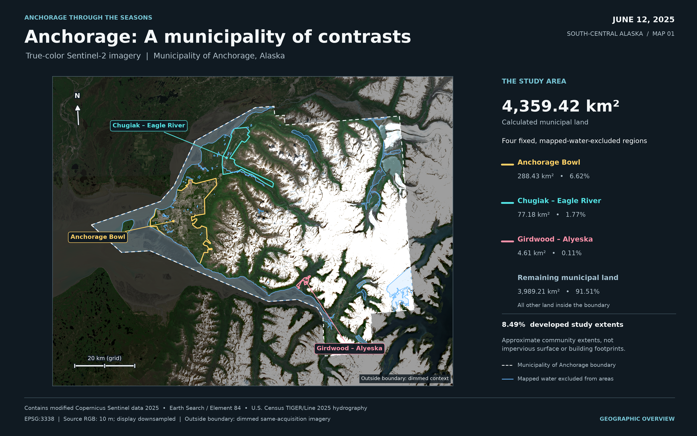
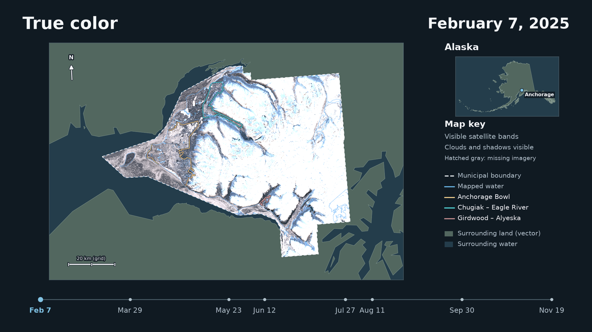
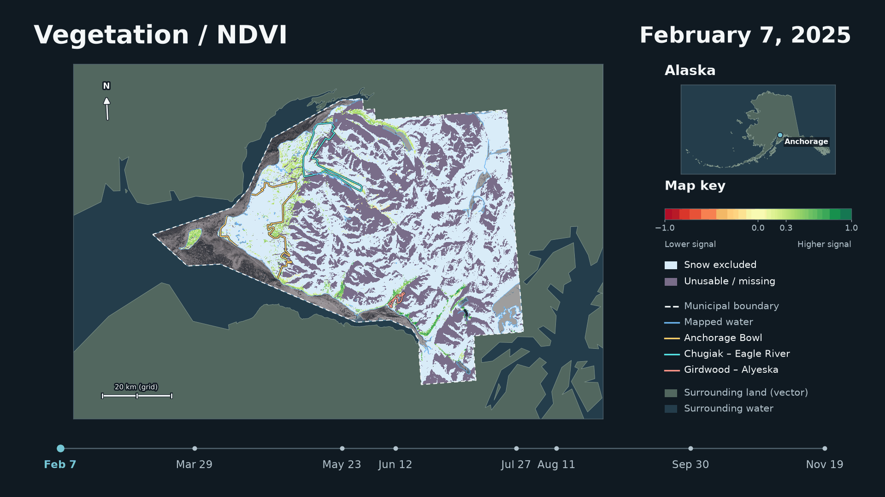
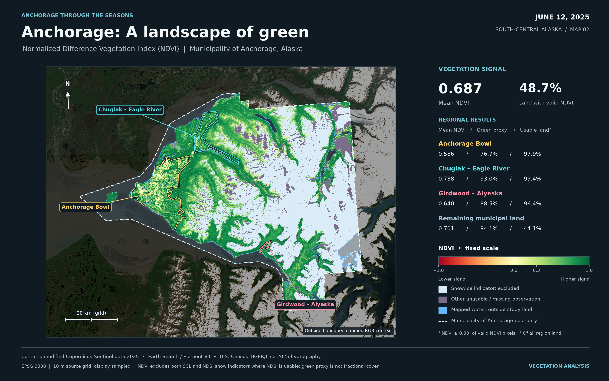
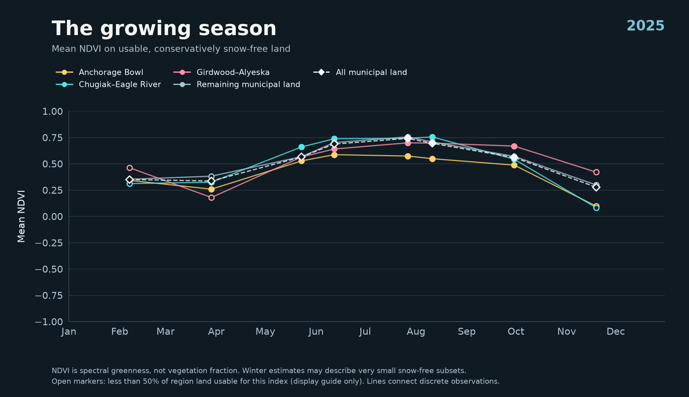
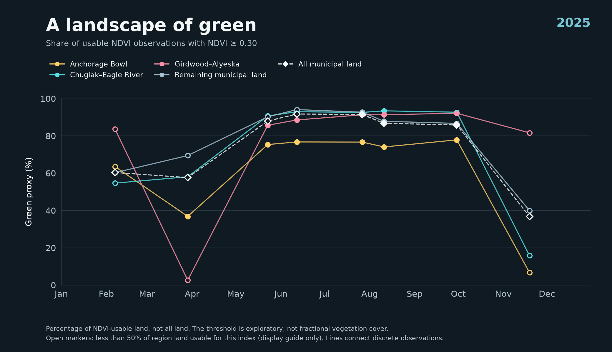
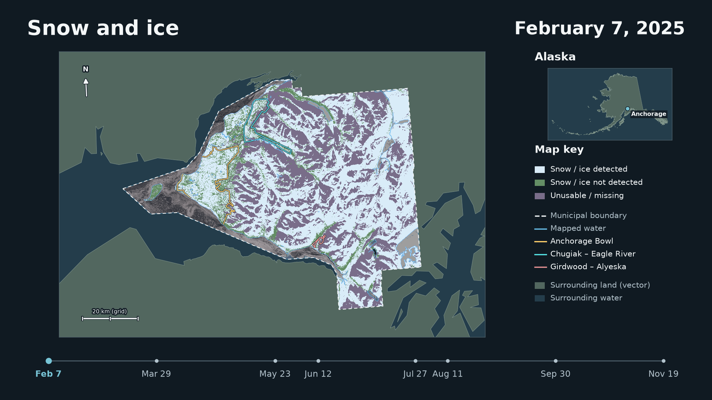
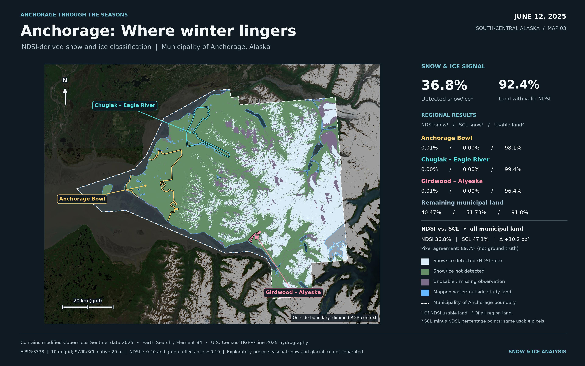
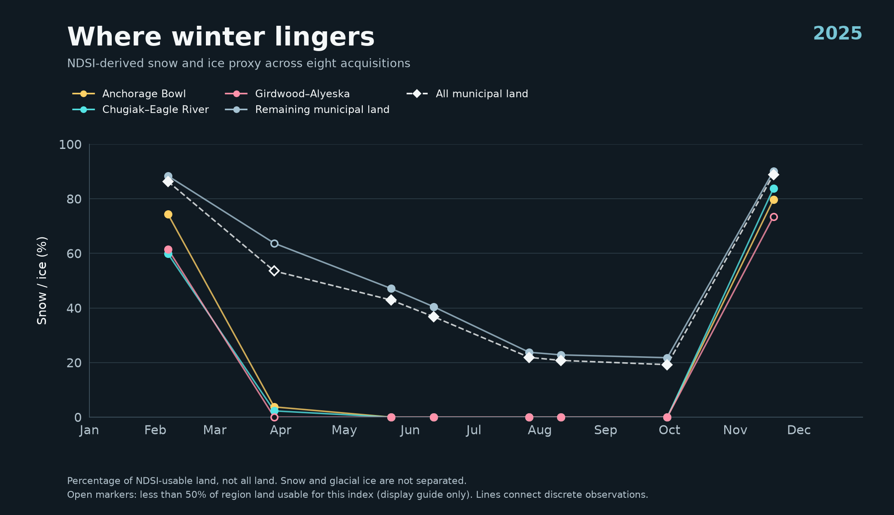
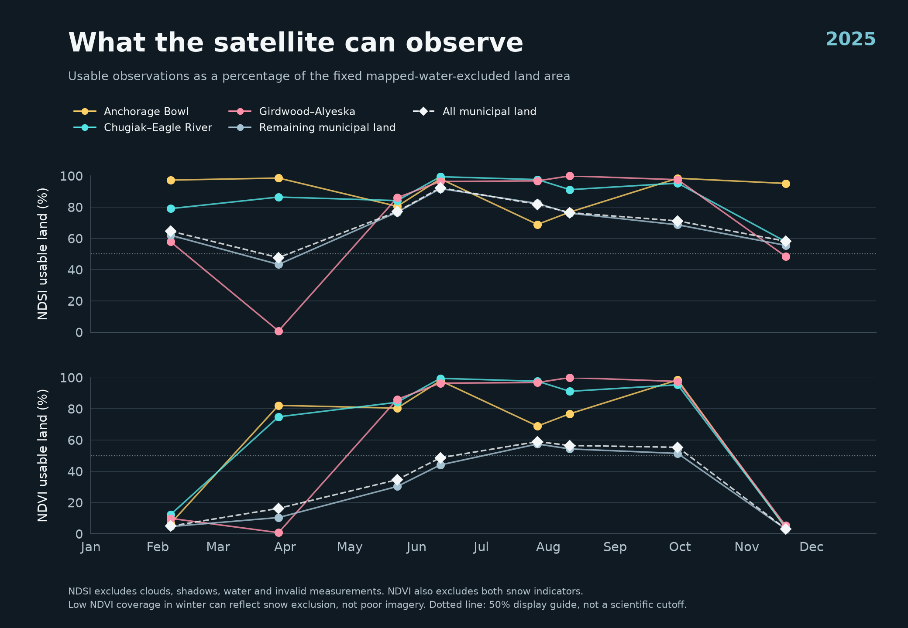

<link rel="stylesheet" href="{{ '/assets/css/anchorage.css' | relative_url }}">

# Anchorage Through the Seasons

[← Back to Portfolio](/)

**Cloud-Native Geospatial Analysis Using Sentinel-2**

How does the landscape of Anchorage change from winter to summer and back again? In this personal investigation of my hometown, I examine vegetation greenness and snow and ice using eight selected Sentinel-2 satellite acquisitions from 2025, across four fixed, mapped-water-excluded study regions totaling approximately 4,359 km². The project brings together geographic vector analysis, multispectral raster processing, cloud-native data access and scientific visualization.

[View source code & documentation](https://github.com/bodle720/DSTopics/tree/main/Anchorage_Seasons) · [Read the Jupyter notebook](https://github.com/bodle720/DSTopics/blob/main/Anchorage_Seasons/Anchorage_Seasons.ipynb) · [Explore the regional statistics](#explore-the-data)

| Selected acquisitions | Fixed land regions | Vector land area |
| --- | --- | --- |
| 8 | 4 | 4,359.425 km² |

**Key observations:** Municipal mean NDVI reached **0.741** on July 27 among usable, conservatively snow-free observations. The lowest observed municipal snow/ice proxy was **19.24%** of NDSI-usable observations on September 30. The patterns are conditional on the land that could be observed; coverage changes considerably over the year.

*Imagery: Contains modified Copernicus Sentinel data 2025.*

*Tools:* QGIS, GeoPandas, Shapely, pyproj, Rasterio, NumPy, pandas, Matplotlib, Pillow, Sentinel-2, STAC, GeoTIFF/COG, AWS S3, ESRI shapefiles, GeoJSON, HTML, CSS and JavaScript.

## A Municipality of Contrasts

<figure class="anchorage-figure">
  
  <figcaption>Geographic overview, June 12, 2025. Community study regions are shown within the municipal boundary. <a href="/assets/images/anchorage/anchorage_20250612_geographic_overview.png">Open full size</a>.</figcaption>
</figure>

Anchorage includes densely settled communities as well as an extensive surrounding landscape of forests, mountains, snowfields and glaciers. The geographic study regions remain fixed throughout the investigation, allowing seasonal comparisons without moving the boundaries. Mapped water is excluded from the land denominator.

| Study region | Vector land area (km²) |
| --- | ---: |
| Anchorage Bowl | 288.428 |
| Chugiak–Eagle River | 77.175 |
| Girdwood–Alyeska | 4.608 |
| Remaining Municipal Land | 3,989.214 |
| **All Municipal Land** | **4,359.425** |

The three community study extents account for approximately **8.49%** of the calculated municipal land area. They include natural land as well as built environments; their combined area is not an estimate of impervious surface or exclusively developed land. All Municipal Land is the union of the four regions, not a fifth independent study region.

## A Year from Space

<figure class="anchorage-figure">
  
  <figcaption>True-color imagery across eight selected Sentinel-2 acquisitions. Clouds and shadows remain visible in this visualization. <a href="/assets/images/anchorage/anchorage_2025_true_color.gif">Open full size</a>.</figcaption>
</figure>

The sequence spans February 7, March 29, May 23, June 12, July 27, August 11, September 30 and November 19, 2025. These are eight actual acquisitions, not interpolated daily imagery or a continuous monthly record. The visible transition from winter snow to summer vegetation and back to winter provides a geographic context for the spectral measurements that follow.

## The Growing Season

<figure class="anchorage-figure">
  
  <figcaption>Vegetation greenness through the seasons, with unusable observations distinguished from measured values. <a href="/assets/images/anchorage/anchorage_2025_vegetation.gif">Open full size</a>.</figcaption>
</figure>

<figure class="anchorage-figure">
  
  <figcaption>June 12, 2025: spectral greenness in the community regions and the surrounding municipal landscape. <a href="/assets/images/anchorage/anchorage_20250612_vegetation.png">Open full size</a>.</figcaption>
</figure>

NDVI (Normalized Difference Vegetation Index) measures the contrast between reflected near-infrared and red light. Higher values generally indicate stronger spectral greenness. Here, vegetation measurements exclude invalid observations and pixels identified as snow or ice by either snow indicator.

On June 12, mean NDVI was 0.586 in Anchorage Bowl, 0.738 in Chugiak–Eagle River, 0.640 in Girdwood–Alyeska and 0.701 in the remaining municipal land. Usable NDVI coverage exceeded 96% in the three community regions, but was only 44.08% in the remaining land. The municipal mean reached its highest sampled value of 0.741 on July 27, when 58.97% of fixed municipal land was usable for NDVI.

<figure class="anchorage-figure">
  
  <figcaption>Mean NDVI among usable, conservatively snow-free cells; hollow markers denote coverage below 50%. <a href="/assets/images/anchorage/anchorage_2025_ndvi_chart.png">Open full size</a>.</figcaption>
</figure>

<figure class="anchorage-figure">
  
  <figcaption>Share of NDVI-usable cells with NDVI ≥ 0.30; not a fractional vegetation cover measurement. <a href="/assets/images/anchorage/anchorage_2025_green_proxy_chart.png">Open full size</a>.</figcaption>
</figure>

The community observations show increased greenness during the spring and summer, with a general decline into autumn. Chugiak–Eagle River had higher mean NDVI than Anchorage Bowl on each of the five May–September acquisitions. The green proxy is the proportion of usable NDVI cells reaching an exploratory threshold, not the proportion of the entire region physically covered by vegetation. For example, on June 12 the municipal green proxy was 91.73%, but NDVI was usable over only 48.68% of fixed municipal land.

## Where Winter Lingers

<figure class="anchorage-figure">
  
  <figcaption>Seasonal snow and ice detection using NDSI and a minimum green reflectance threshold. <a href="/assets/images/anchorage/anchorage_2025_snow_ice.gif">Open full size</a>.</figcaption>
</figure>

<figure class="anchorage-figure">
  
  <figcaption>June 12, 2025: the difference between the nearly snow-free community observations and snow/ice in the surrounding mountains. <a href="/assets/images/anchorage/anchorage_20250612_snow_ice.png">Open full size</a>.</figcaption>
</figure>

NDSI (Normalized Difference Snow Index) exploits the contrast between green and shortwave-infrared reflectance. On June 12, the snow/ice proxy was 36.81% of usable municipal NDSI observations, with 92.38% of fixed municipal land usable. In the remaining municipal land the proxy was 40.47%, compared with less than 0.02% in each community region. Snow and ice persist well into the warmer months outside the community extents.

<figure class="anchorage-figure">
  
  <figcaption>Snow/ice proxy as a percentage of NDSI-usable land, with low-coverage markers. <a href="/assets/images/anchorage/anchorage_2025_snow_ice_chart.png">Open full size</a>.</figcaption>
</figure>

The municipal proxy declined from 86.33% on February 7 to a sampled minimum of 19.24% on September 30, then rose to 88.88% by November 19. NDSI coverage on those dates was 64.62%, 71.15% and 58.18%, respectively. The detection rule does not separate seasonal snow from glacial ice. Regional contrasts are descriptive: elevation, terrain, glaciers and vegetation type were not controlled, so the results do not establish a causal effect of urbanization.

## What the Satellite Can Observe

<figure class="anchorage-figure">
  
  <figcaption>Usable observations expressed as percentages of each fixed region’s land cells. <a href="/assets/images/anchorage/anchorage_2025_observation_coverage_chart.png">Open full size</a>.</figcaption>
</figure>

A satellite image can cover a region geographically while providing little usable scientific information. Clouds, cirrus, terrain and cloud shadows, unclassified pixels, water classifications and invalid spectral values can remove cells from analysis. NDVI coverage can be substantially lower still, because the vegetation calculation conservatively excludes snow and ice.

### A particularly important example: Girdwood–Alyeska, March 29

All **46,077** fixed land cells had assigned source imagery. Yet only **342 cells (0.74224%)** were usable for either index.

| Observation category | Cells | Share of fixed land |
| --- | ---: | ---: |
| Clouds and cirrus | 34,154 | 74.12375% |
| Unclassified | 11,573 | 25.11665% |
| SCL water | 8 | 0.01736% |
| Usable for both indices | 342 | 0.74224% |
| **Total** | **46,077** | **100%** |

Among these 342 cells, zero met the snow/ice detection rule, nine met the NDVI greenness threshold (2.63158%), and mean NDVI was 0.179701. NDSI and SCL snow classifications agreed on every usable cell. Those are valid measurements of the observed subset, **not representative estimates of Girdwood–Alyeska as a whole**. Even 100% agreement is not meaningful regional validation when almost all land is excluded; SCL is not independent ground truth in any case.

At the municipal level on March 29, cloud/cirrus coverage was 49.93%, NDSI usable coverage was 47.69%, and NDVI usable coverage was only 16.28%. In February and November, municipal shadow coverage reached 34.19% and 40.14%, respectively. Winter terrain shadows and deliberate snow exclusion are important reasons for low winter vegetation coverage. The February municipal green proxy of 60.36%, for instance, describes only the 4.91% of municipal land usable for NDVI.

The charts use hollow markers for observations with usable coverage below 50%. That cutoff is a visual caution guide, not a validated representativeness threshold. Lines connect sampled dates as visual guides; they are not measured values between acquisitions.

## Explore the Data

Select a date below to inspect the five reporting categories. The default view is June 12; the additional measurements can be expanded. Scroll horizontally to see all columns, especially in the expanded table.



### Measurement reference

Every percentage has a specific denominator. Here, *fixed land* means rasterized cells within a mapped-water-excluded region. Each projected cell is 100 m² (0.0001 km²). Observed areas are not extrapolated to the rest of the region.

| Measurement | Definition and denominator |
| --- | --- |
| Snow / ice | 100 × detected snow/ice cells ÷ NDSI-valid cells. |
| NDSI usable | 100 × NDSI-valid cells ÷ all fixed regional land cells. |
| Mean NDVI | Arithmetic mean of NDVI over valid, conservatively snow-free NDVI cells; sum of values ÷ NDVI-valid cell count. |
| Green proxy | 100 × cells with NDVI ≥ 0.30 ÷ NDVI-valid cells. |
| NDVI usable | 100 × NDVI-valid cells ÷ all fixed regional land cells. |
| SCL snow | 100 × SCL class 11 cells among NDSI-valid cells ÷ NDSI-valid cells. |
| NDSI–SCL agreement | 100 × matching binary snow/non-snow classifications ÷ NDSI-valid cells. This is a comparison, not accuracy against ground truth. |
| Cloud | 100 × SCL classes 8, 9 and 10 cells ÷ all fixed regional land cells. |
| Shadow | 100 × SCL classes 2 and 3 cells ÷ all fixed regional land cells. |
| Observed snow / ice | Detected snow/ice cell count × 0.0001 km². |
| Observed green | Green-proxy cell count × 0.0001 km². |
| NDVI retention | 100 × NDVI-valid cells ÷ conservative snow-free candidates (NDSI-valid cells identified as snow by neither snow indicator). |

A measured zero means no cells met the relevant detection rule (or the measured value was zero). N/A means no valid denominator, and must not be interpreted as zero. Displayed percentages are rounded; observed areas retain four decimal places to distinguish single-cell increments from zero. The combined municipality is calculated from pooled counts and valid observations, not an unweighted average of four regional percentages.

[View the full scientific CSV on GitHub](https://github.com/bodle720/DSTopics/blob/main/Anchorage_Seasons/results/anchorage_2025_seasonal_regional_statistics.csv).

## Conclusions

These eight satellite observations capture a pronounced seasonal contrast in Anchorage: high winter snow/ice proxy values, stronger growing-season greenness, and substantial snow/ice persistence in the surrounding municipal territory. The highest sampled municipal mean NDVI was in July and the lowest sampled snow/ice proxy was in September. Community extents and the remaining land exhibit distinct observed patterns, but the study does not isolate their causes.

A central lesson is that **observation coverage matters as much as the spectral index**. A reliable interpretation must distinguish valid measurements from missing data, report their denominators, and avoid generalizing conditional measurements to unseen land. The March Girdwood example illustrates why a plausible numerical result may still be unsuitable for a region-wide inference.

## Technical Appendix

### Geographic vector processing and the analysis grid

The workflow began with ESRI shapefiles and geographic inspection in QGIS. GeoPandas, Shapely and pyproj were used to manage coordinate systems, construct and inspect study geometries, exclude mapped hydrography, and establish a non-overlapping partition of municipal land. The community polygons and remaining land were validated for geometry integrity, coverage and overlap. The original QGIS display environment used EPSG:2964; the scientific raster workflow uses EPSG:3338 (NAD83 / Alaska Albers), an equal-area projected CRS in meters.

The common grid is 10,739 columns × 8,299 rows at 10 m pixel spacing. Each cell therefore represents 100 m² of projected area. Fixed regional geometries were rasterized on this grid and reused for each date. Raster-derived regional areas may differ slightly from vector-derived areas because a raster represents geometry discretely. B11 and SCL are native 20 m data aligned onto the common 10 m grid; this alignment does not create new independent 10 m measurements from those bands.

### Imagery discovery, mosaicking and provenance

Sentinel-2 Collection 1 Level-2A imagery was discovered through the Earth Search STAC catalog. From 200 initially discovered acquisition groups, 62 geographically qualifying groups were screened for observation quality, and eight dates were selected. Multiple covering scenes were mosaicked and reprojected to the common scientific grid using Rasterio. The public reproducibility records retain the fixed study geometries, selected scene manifests, historical acquisition records and methodology. Coverage screening and date selection make this an exploratory sample, not a systematic continuous record.

GeoTIFF preserves the raster's CRS, affine transform and geospatial metadata. Cloud Optimized GeoTIFFs (COGs) organize raster data and overviews for efficient partial access. The original workflow checked raster alignment, regional accounting and full-resolution equality of the converted COG against its source.

### Spectral bands and reflectance

| Band | Spectral region | Native resolution | Role |
| --- | --- | ---: | --- |
| B02 | Blue | 10 m | True-color blue |
| B03 | Green | 10 m | True-color green; NDSI; minimum green reflectance |
| B04 | Red | 10 m | True-color red; NDVI |
| B08 | Near infrared (NIR) | 10 m | NDVI |
| B11 | Shortwave infrared 1 (SWIR1) | 20 m | NDSI |
| SCL | Scene Classification Layer | 20 m | Observation-quality and snow screening |

The imagery stores encoded integer digital numbers (DN). The verified conversion for all eight selected acquisitions is applied to the spectral bands before computing indices:

Reflectance = DN × 0.0001 − 0.1

True color uses B04, B03 and B02 as the red, green and blue channels, respectively. Index calculations use decoded reflectance, not uncorrected digital numbers.

### NDVI and the green proxy

NDVI = (B08 − B04) / (B08 + B04)

Vegetation generally absorbs red light for photosynthesis while leaf structure strongly reflects near-infrared light. A normalized difference emphasizes this contrast. The exploratory green threshold is:

NDVI ≥ 0.30

This is an indicator of spectral greenness, not a calibrated fractional vegetation cover estimate or a species classification. Mean NDVI and green proxy are computed only over usable, conservatively snow-free observations.

### NDSI and the snow/ice proxy

NDSI = (B03 − B11) / (B03 + B11)

Snow generally reflects green wavelengths strongly but absorbs more shortwave infrared radiation. A normalized difference captures that contrast. The exploratory snow/ice rule requires both:

NDSI ≥ 0.40 &nbsp; and &nbsp; B03 reflectance ≥ 0.10

The green-reflectance condition helps reject dark observations. The result is a snow/ice proxy; it does not distinguish glacial ice from seasonal snow. Both indices require valid spectral inputs and valid normalization denominators.

### Scene Classification Layer and masking

SCL supplies a categorical assessment of scene conditions. It is used as a quality screen and a second snow indicator, not independent field truth.

| SCL class | Description | Initial quality eligibility |
| --- | --- | --- |
| 0, 1 | No data; saturated/defective | Excluded |
| 2, 3 | Terrain shadow; cloud shadow | Excluded |
| 4, 5 | Vegetation; non-vegetated | Eligible |
| 6, 7 | Water; unclassified | Excluded |
| 8, 9, 10 | Medium/high probability cloud; thin cirrus | Excluded |
| 11 | Snow/ice | Eligible for NDSI; excluded from NDVI |

The initial eligible classes are 4, 5 and 11, subject to valid reflectance and other scientific requirements. NDSI is calculated from eligible valid green and SWIR1 observations. The conservative snow-free candidate mask retains NDSI-valid cells only when neither the NDSI detection rule nor SCL class 11 indicates snow/ice. NDVI further requires valid red and near-infrared reflectance. Invalid or excluded observations are stored as missing, not assigned a numerical zero. The mask is why winter NDVI coverage can be very low even when geographic imagery assignment is complete.

### Cloud-native access demonstration

As a separate engineering exercise, a municipality-wide COG was uploaded to private AWS S3 and a 200 × 200 pixel geographic window was read remotely using Rasterio. The remote COG was also displayed in QGIS. This demonstrated windowed access rather than requiring a complete local raster download. Exact network transfer volumes were not measured and rendering performance was not benchmarked. The eight-date seasonal analysis used public source imagery and local processing; it was not a deployed cloud processing service or a custom STAC server.

### Reproducibility and scientific limitations

The [processing scripts](https://github.com/bodle720/DSTopics/tree/main/Anchorage_Seasons/scripts) and [reproducibility guide](https://github.com/bodle720/DSTopics/blob/main/Anchorage_Seasons/reproducibility/README.md) document the workflow and inputs. The original run reported successful geometry, full-resolution COG, grid and accounting checks. A complete rebuild from a fresh clone has not been independently tested; large raster and local QGIS data are not part of the public repository. This is descriptive remote sensing, not a trained machine learning model, independent field-validated land-cover classification or causal study.

## Data Sources and Attribution

**Contains modified Copernicus Sentinel data 2025.** [Copernicus Sentinel data legal notice](https://ewds.climate.copernicus.eu/licences/ec-sentinel).

- Sentinel-2 Collection 1 Level-2A imagery accessed using [Earth Search / Element 84](https://earth-search.aws.element84.com/v1) (`sentinel-2-c1-l2a`); see the [AWS Open Data registry](https://registry.opendata.aws/sentinel-2-l2a-cogs/).
- Municipal boundary: U.S. Census Bureau [TIGERweb](https://tigerweb.geo.census.gov/). Mapped-water exclusion: [2025 TIGER/Line area-water shapefiles](https://www.census.gov/geographies/mapping-files/time-series/geo/tiger-line-file.2025.html). Derived study regions are independently prepared, not official Census Bureau products.
- Alaska locator context in the animations: [QGIS Alaska sample dataset](https://github.com/qgis/QGIS-Sample-Data), adapted from VMAP0 vector data (converted to shapefile by Andras Fabian). Only rendered visualizations are included here, not the raw sample dataset. No government-agency endorsement is implied.

[Source code and project documentation](https://github.com/bodle720/DSTopics/tree/main/Anchorage_Seasons) · [Jupyter notebook](https://github.com/bodle720/DSTopics/blob/main/Anchorage_Seasons/Anchorage_Seasons.ipynb) · [Image credits](/image-credits/)

[← Back to Portfolio](/)
